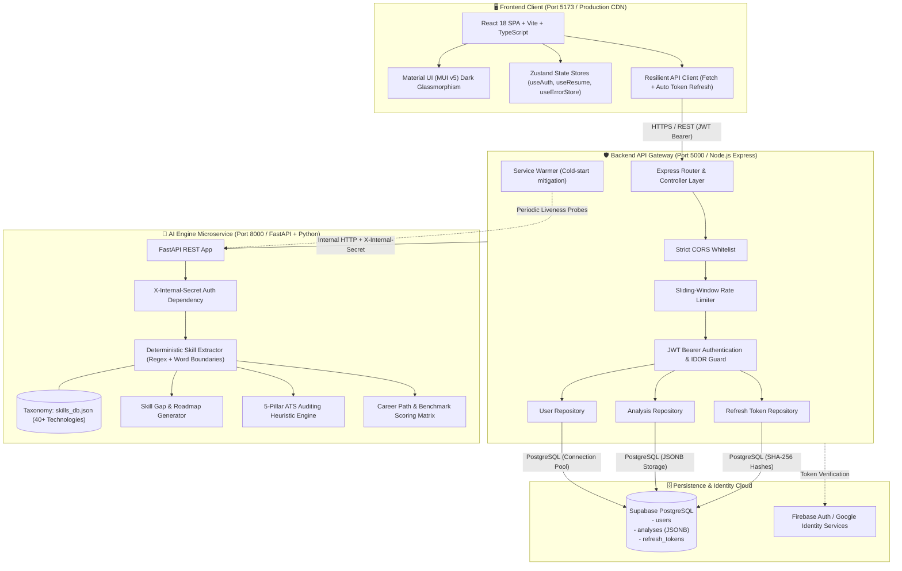
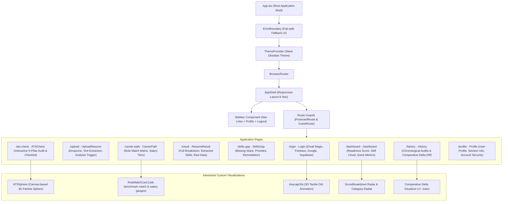
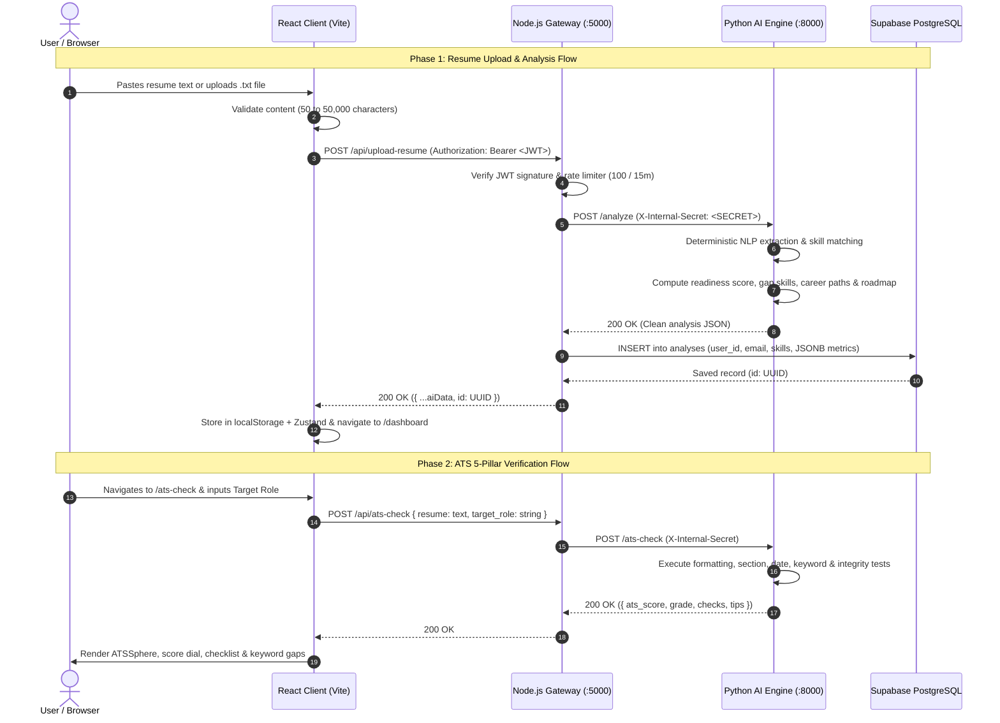
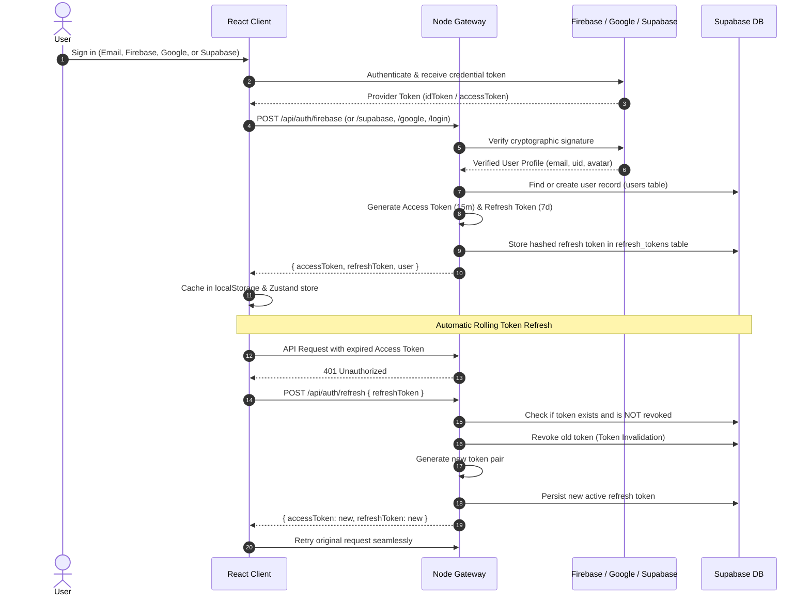
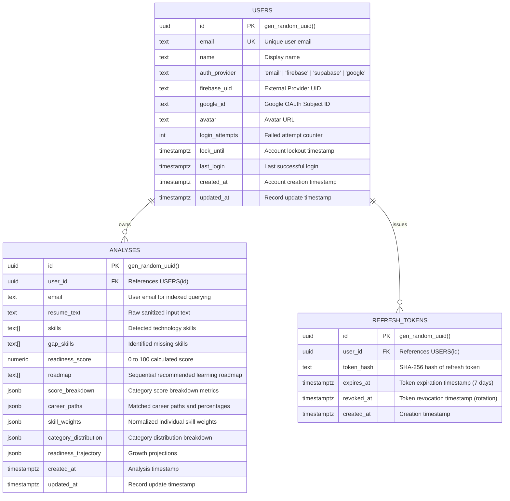

<div align="center">

# ⚡ Futrix AI — Career Intelligence Twin

### Enterprise-Grade Deterministic Career Intelligence & AI Resume Optimization Platform

**Zero-Hallucination Resume Analysis · 5-Pillar ATS Scoring · Skill Gap Diagnostic · Interactive Career Path Modeling**

[](https://nodejs.org)
[](https://react.dev)
[](https://www.typescriptlang.org/)
[](https://vitejs.dev)
[](https://python.org)
[](https://fastapi.tiangolo.com)
[](https://supabase.com)
[](https://firebase.google.com)

</div>

---

## 📑 Table of Contents

- [System Architecture](#-system-architecture)
- [Component Hierarchy & UI System](#-component-hierarchy--ui-system)
- [End-to-End Data & Execution Flow](#-end-to-end-data--execution-flow)
- [Multi-Provider Authentication & Token Rotation](#-multi-provider-authentication--token-rotation)
- [Deterministic AI Engine & 5-Pillar ATS Heuristics](#-deterministic-ai-engine--5-pillar-ats-heuristics)
- [Project Directory Structure](#-project-directory-structure)
- [API Endpoint Reference](#-api-endpoint-reference)
- [Database Entity-Relationship Model](#-database-entity-relationship-model)
- [Local Development & Testing](#-local-development--testing)
- [Production Deployment](#-production-deployment)
- [Security Model & Rate Limiting](#-security-model--rate-limiting)

---

## 📐 System Architecture

Futrix AI is architected as an enterprise decoupled monorepo comprising a modern Single-Page Application (SPA), a secure API Gateway/BFF with persistent Supabase PostgreSQL storage, and a high-throughput deterministic Python NLP Microservice.



---

## 🧩 Component Hierarchy & UI System

The client is built using a clean hierarchical structure with dedicated layout shells, protected routes, and custom interactive visualization modules:



---

## 🔄 End-to-End Data & Execution Flow



---

## 🔐 Multi-Provider Authentication & Token Rotation

Futrix AI supports multi-channel identity verification (Email Magic Link, Google Identity Services, Firebase Admin, and Supabase OAuth), followed by issuance of short-lived access JWTs and rolling refresh tokens stored in PostgreSQL.



---

## 🧠 Deterministic AI Engine & 5-Pillar ATS Heuristics

Unlike non-deterministic LLMs that frequently hallucinate skills or output inconsistent scores, Futrix AI uses a **deterministic, rule-grounded NLP engine**:

1. **Skill Taxonomy & Verification**: Matches exact word boundaries and aliases against `skills_db.json` across 40+ technology categories (Languages, Frameworks, Cloud, Databases, DevOps, Data Science, Architecture).
2. **5-Pillar ATS Audit Engine**:
   - **Formatting Risk**: Flags tables, special symbols, multiple consecutive whitespace, and non-ASCII anomalies.
   - **Section Completeness**: Assesses presence of critical resume sections (`Experience`, `Education`, `Skills`, `Projects`, `Summary`).
   - **Date Parseability**: Detects chronologies, standard month/year formats, and career gaps.
   - **Keyword Alignment**: Cross-matches resume content against target role keywords and highlights missing terminology.
   - **File Integrity & Density**: Audits character count, word density, and bullet point distribution.

---

## 🗂️ Project Directory Structure

```
Futrix-Ai/
├── client/                                 # React 18 + TypeScript + Vite Client
│   ├── src/
│   │   ├── components/                     # Reusable UI widgets & layouts
│   │   │   ├── charts/
│   │   │   │   └── ATSSphere.tsx           # Interactive 3D Canvas ATS particle sphere
│   │   │   ├── ui/                         # Modern tactile UI components (KeycapOrb, etc.)
│   │   │   ├── RoleMatchCard.tsx           # Career path matching card
│   │   │   ├── ScoreRing.tsx               # Circular readiness score indicator
│   │   │   └── Sidebar.tsx                 # Navigation bar with responsive mobile drawer
│   │   ├── config/                         # Theme definitions & configuration
│   │   ├── pages/                          # Primary view routes
│   │   │   ├── ATSCheck.tsx                # ATS 5-pillar heuristic checker
│   │   │   ├── CareerPath.tsx              # Role matching & salary projection
│   │   │   ├── Dashboard.tsx               # Overview dashboard & quick actions
│   │   │   ├── History.tsx                 # Historical audit records & comparative delta
│   │   │   ├── Login.tsx                   # Multi-provider login screen
│   │   │   ├── Profile.tsx                 # User profile & account preferences
│   │   │   ├── ResumeResult.tsx            # Deep-dive analysis view
│   │   │   ├── SkillsGap.tsx               # Skill gap analysis & prioritized roadmap
│   │   │   └── UploadResume.tsx            # Dropzone & resume submission page
│   │   ├── services/                       # API integration layer
│   │   │   ├── apiService.ts               # Primary resilient HTTP client with auto-refresh
│   │   │   ├── api.ts                      # Axios service instance
│   │   │   ├── firebase.ts                 # Firebase client SDK initialization
│   │   │   ├── supabase.ts                 # Supabase client SDK initialization
│   │   │   └── resumeParser.ts             # Client-side text parsing & validation
│   │   ├── store/                          # Zustand state stores
│   │   │   ├── useAuth.ts                  # Authentication & session store
│   │   │   ├── useResume.ts                # Active analysis result store
│   │   │   └── useErrorStore.ts            # Global error notification state
│   │   └── styles/                         # Modular CSS styles
│   ├── vite.config.ts                      # Vite build configuration & dev proxy error handler
│   └── package.json
│
├── node-api/                               # Express Gateway & BFF (Node.js)
│   ├── db/
│   │   ├── supabaseClient.js               # Supabase PostgreSQL client connection pool
│   │   ├── userRepo.js                     # User entity database operations
│   │   ├── analysisRepo.js                 # Analysis entity database operations
│   │   └── refreshTokenRepo.js             # Token persistence & rotation repository
│   ├── middleware/
│   │   ├── auth.js                         # JWT Bearer token verification middleware
│   │   └── rateLimiter.js                  # Sliding-window rate limiting
│   ├── routes/
│   │   └── userRoutes.js                   # Application route handlers (Auth, Resume, ATS, Jobs)
│   ├── utils/
│   │   ├── authUtils.js                    # JWT signing & verification helpers
│   │   ├── firebaseAdmin.js                # Firebase Admin SDK initialization
│   │   └── serviceWarmer.js                # Cold-start keep-alive warmer
│   ├── tests/
│   │   └── test-db-integration.js          # 31-point comprehensive integration test suite
│   ├── server.js                           # Express entry point & middleware orchestrator
│   └── package.json
│
├── python-ai/                              # Deterministic NLP Microservice (FastAPI)
│   ├── tests/
│   │   ├── test_ats.py                     # ATS heuristic unit & property test suite
│   │   └── test_skills.py                  # NLP skill extraction test suite
│   ├── ai_engine.py                        # Core NLP extraction, scoring, & ATS algorithm
│   ├── skills_db.json                      # 40+ technology taxonomy & benchmark skills
│   ├── main.py                             # FastAPI endpoints & internal auth verification
│   └── requirements.txt                    # Python dependencies (FastAPI, Uvicorn, Pydantic)
│
├── docs/                                   # Project documentation & architectural blueprints
│   ├── DEPLOYMENT_GUIDE.md                 # Production deployment runbook
│   ├── FUTRIX_AI_MASTER_SPECIFICATION.md   # Complete system specification
│   └── MIGRATION.md                        # Database migration & schema history
├── package.json                            # Monorepo root scripts (dev, test, lint)
└── README.md
```

---

## 🔌 API Endpoint Reference

### Gateway API (`node-api`) — Port `5000` (Public / BFF)

| Method | Endpoint | Auth | Rate Limit | Description |
|:------:|:---------|:----:|:----------:|:------------|
| `GET` | `/health` | Public | — | Health probe, uptime, DB connectivity status |
| `POST` | `/api/login` | Public | 10 / 15m | Passwordless / email magic login & token issuance |
| `POST` | `/api/auth/firebase` | Public | 20 / 15m | Verify Firebase ID token & issue JWT pair |
| `POST` | `/api/auth/supabase` | Public | 20 / 15m | Verify Supabase access token & issue JWT pair |
| `POST` | `/api/auth/google` | Public | 20 / 15m | Verify Google OAuth2 / GIS credential |
| `POST` | `/api/auth/refresh` | Public | — | Rotate refresh token (revokes old token) |
| `POST` | `/api/auth/logout` | Bearer JWT | — | Invalidate all refresh tokens for current user |
| `GET` | `/api/auth/verify` | Bearer JWT | — | Verify access token validity and return user details |
| `GET` | `/api/profile` | Bearer JWT | — | Fetch authenticated user's profile |
| `PUT` | `/api/profile` | Bearer JWT | — | Update profile name and avatar |
| `POST` | `/api/upload-resume` | Bearer JWT | 100 / 15m | Analyze resume via Python AI and persist results |
| `GET` | `/api/history` | Bearer JWT | — | Fetch user's analysis history (scoped by email) |
| `GET` | `/api/compare` | Bearer JWT | — | Compare two analyses by `?id1=&id2=` with IDOR check |
| `POST` | `/api/jobs/match` | Bearer JWT | — | Rank target job roles against detected skills |
| `POST` | `/api/ats-check` | Bearer JWT | — | Run 5-pillar ATS heuristic check on resume text |

### Python AI Engine (`python-ai`) — Port `8000` (Internal Service)

> Protected via `X-Internal-Secret` header matching `INTERNAL_API_SECRET`.

| Method | Endpoint | Description |
|:------:|:---------|:------------|
| `GET` | `/health` | Microservice liveness probe |
| `POST` | `/analyze` | Deterministic NLP skill extraction, readiness score, and roadmap |
| `POST` | `/ats-check` | 5-pillar ATS heuristic audit (formatting, sections, dates, keywords, integrity) |
| `POST` | `/score-breakdown`| Granular category score breakdown calculation |
| `POST` | `/career-path` | Benchmark comparison against career catalog |
| `POST` | `/compare` | Comparative diff between two resume payloads |

---

## 🗃️ Database Entity-Relationship Model



---

## 🚀 Local Development & Testing

### Prerequisites
- **Node.js** v18+ (tested on Node v22)
- **Python** v3.11+ (tested on Python 3.14)
- **Supabase** instance (or active development credentials)

### 1. Installation

```bash
# Clone the repository
git clone https://github.com/kirtan597/Futrix-Ai.git
cd Futrix-Ai

# Install root dependencies
npm install

# Install all sub-project dependencies
npm run install:all

# Install Python microservice requirements
cd python-ai && pip install -r requirements.txt && cd ..
```

### 2. Environment Configuration

Create `.env` files in `node-api/`, `client/`, and `python-ai/`:

```bash
# Node API: node-api/.env
PORT=5000
NODE_ENV=development
SUPABASE_URL=https://your-project.supabase.co
SUPABASE_SERVICE_ROLE_KEY=your_supabase_service_role_key
JWT_SECRET=your_jwt_secret_at_least_32_chars
JWT_REFRESH_SECRET=your_jwt_refresh_secret_at_least_32_chars
INTERNAL_API_SECRET=shared_secret_between_node_and_python
PYTHON_URL=http://localhost:8000
FRONTEND_URL=http://localhost:5173

# Python AI: python-ai/.env
INTERNAL_API_SECRET=shared_secret_between_node_and_python
ALLOWED_ORIGINS=http://localhost:5000,http://localhost:5173

# Client: client/.env
VITE_API_URL=http://localhost:5000
```

### 3. Running Services Concurrently

Run all three tiers with a single command:

```bash
npm run dev
```

| Service | Port | Local URL |
|:--------|:----:|:----------|
| **React Client (Vite)** | `5173` | [http://localhost:5173](http://localhost:5173) |
| **Node API Gateway** | `5000` | [http://localhost:5000/health](http://localhost:5000/health) |
| **Python AI Engine** | `8000` | [http://localhost:8000/health](http://localhost:8000/health) |

### 4. Running Verification Test Suites

```bash
# Run all automated test suites
npm test

# Or run tests individually per service:
npm run test:python   # 74 pytest assertions (NLP + ATS heuristics)
npm run test:node     # 31 Node.js integration assertions (DB + Auth + IDOR)
npm run test:client   # TypeScript compilation + Vite production bundle + ESLint
```

---

## ☁️ Production Deployment

Futrix AI is optimized for cloud deployment across Render, Netlify, and Supabase:

- **Frontend Client**: Deployed to Netlify / Vercel with SPA routing rewrites.
- **Node Gateway**: Deployed as a Web Service on Render (Docker / Node 18+).
- **Python AI Microservice**: Deployed as a Web Service on Render (Docker / Python 3.11+).
- **Database**: Managed Supabase PostgreSQL with automated daily backups.

Refer to [`docs/DEPLOYMENT_GUIDE.md`](docs/DEPLOYMENT_GUIDE.md) for step-by-step production setup and DNS routing.

---

## 🔒 Security Model & Rate Limiting

- **Zero-Trust Hop-by-Hop Authentication**: Client communicates strictly via signed JWT Bearer tokens. Internal calls from Node Gateway to Python AI require `X-Internal-Secret`.
- **Anti-IDOR Isolation**: Analysis lookups and comparison endpoints enforce cryptographic identity verification (`req.user.email === analysis.email`).
- **Account Brute-Force Protection**: 5 consecutive failed login attempts trigger an automated account lock for 15 minutes.
- **Sliding-Window Rate Limiting**: In-memory rate limiting throttles abuse on public authentication endpoints.
- **Strict Content Security**: Cross-Origin-Opener-Policy (`same-origin-allow-popups`) and strict origin whitelisting prevent unauthorized cross-origin embeddings.

---

<div align="center">

**Built with precision by [Kirtan](https://github.com/kirtan597)**

*Futrix AI · Autonomous Career Intelligence*

</div>
