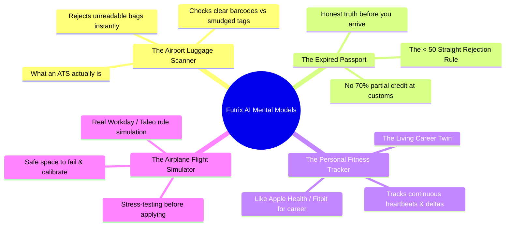
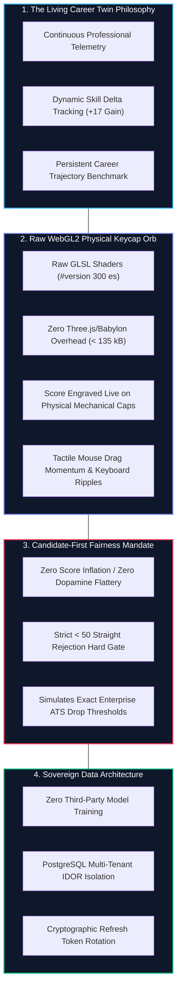
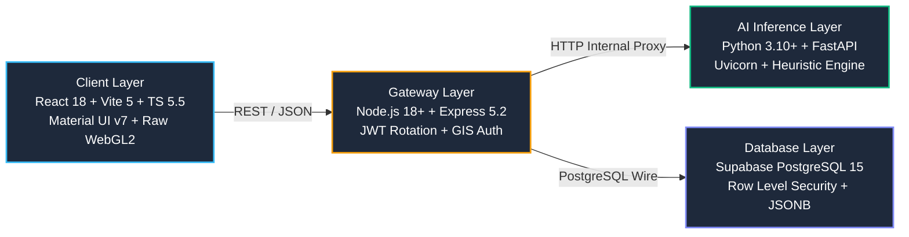
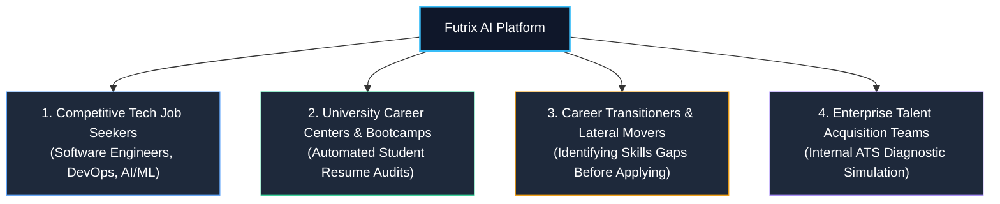
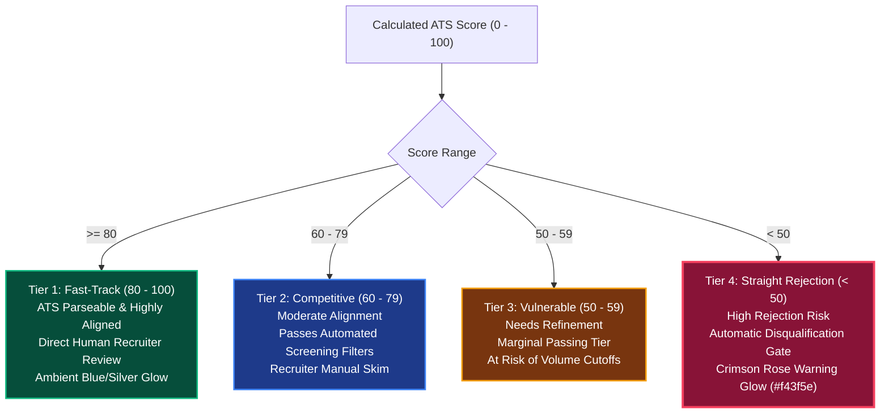
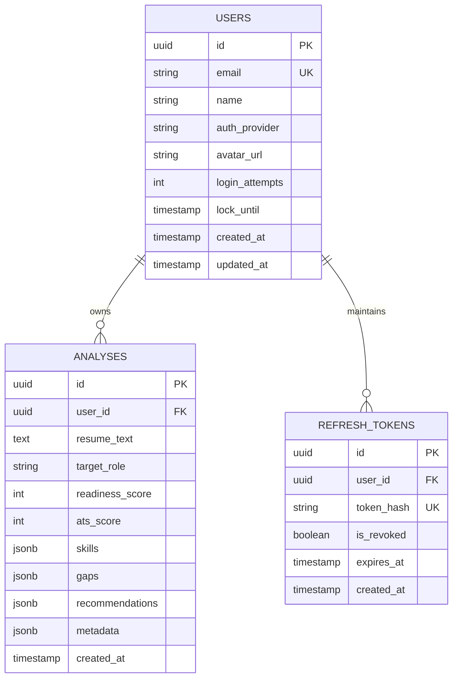
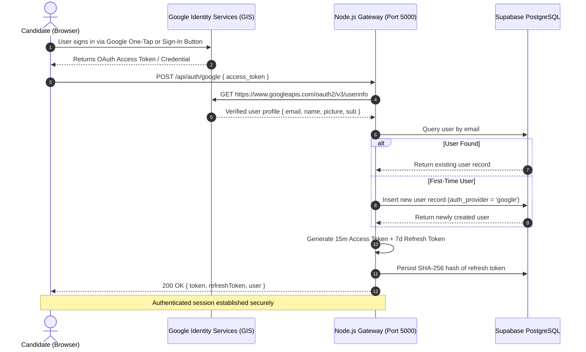

# Futrix AI — Complete Master Architecture, Engineering & Product Blueprint

> **Document Type**: Comprehensive Master Project Specification  
> **Target Audience**: AI Agents, LLM Context Windows, Technical Architects, Investors & Stakeholders  
> **Project Version**: 2.0.0 Enterprise  
> **Status**: Verified Production Release  
> **Last Updated**: October 2026  

---

## 📌 1. Executive Summary & The Core Idea

### What is Futrix AI?
**Futrix AI** is an enterprise-grade **AI Career Twin and Resume Diagnostic Platform**. It replaces the broken, opaque world of automated job applications with transparent mathematical diagnostics, persistent career telemetry, and an interactive 3D WebGL visual interface.

### The Problem in Plain English
Over **75% of qualified resumes are discarded by corporate robotic filters** (known as Applicant Tracking Systems or ATS, such as Workday, Taleo, and Greenhouse) before any human recruiter ever reads them. Candidates receive cold, automated rejection emails with zero explanation. To make matters worse, commercial resume checkers lie to candidates with inflated scores (giving flawed resumes 85% to create a dopamine rush and sell subscriptions), leading candidates straight into corporate auto-rejections.

### The Futrix AI Solution
1. **The Living Career Twin**: Instead of a disposable single-scan tool, Futrix AI creates a persistent digital twin that models your skills, tracks your score deltas over time (+17 gain), and monitors your alignment with target market roles.
2. **Hardware-Accelerated 3D Physical UX**: A self-contained, GPU-rendered **3D WebGL2 Keycap Orb** where your real ATS score is engraved onto mechanical keycaps that physically react to clicks and typing with realistic ripple wave physics.
3. **The Uncompromising Fairness Rule (< 50 = Straight Rejection)**: If a resume scores under 50, Futrix AI warns you with a bright crimson alert that your resume will be automatically rejected by corporate ATS filters, protecting you from silent rejection loops.
4. **Deterministic Heuristics + Neural Alignment**: Transparent mathematical scoring across 5 vectors (Lexical, Section, Date, Encoding, and Prerequisites) with zero LLM hallucinations.
5. **Enterprise Privacy & Security**: Private Supabase PostgreSQL database with strict IDOR isolation. Zero candidate resume data is ever sold or used to train public foundation models.

---

## 💡 2. Simple Real-World Analogies & Mental Models

To understand why Futrix AI is engineered the way it is, use these four simple real-world comparisons:



### 1. What is an ATS? — *The Airport Luggage Scanner Analogy*
When you check baggage at an airport, automated optical scanners read the barcode tag. If the barcode is clear and properly oriented, your bag glides smoothly through the conveyor belt onto the flight. If the tag is wrinkled, smudged, or upside down, the scanner beeps, rejects it, and shunts it to the rejected siding. An ATS is an airport scanner for resumes. If your resume has tables, multi-column layouts, or weird font ligatures, the corporate robot rejects it immediately. Futrix AI is the pre-flight quality scanner ensuring your tag is 100% readable.

### 2. Why the `< 50` Rejection Gate? — *The Expired Passport Analogy*
If you show up at international border control with an expired passport or a torn photo, the immigration officer does not say *"Well, you're 70% fine, go ahead."* You are turned around on the spot — zero exceptions. That is what a score **under 50** means in enterprise hiring. Futrix AI refuses to sugarcoat this reality: a score under 50 triggers an immediate **Straight Rejection (`High Rejection Risk`)** alert so you fix it before wasting your dream application.

### 3. What is the Career Twin? — *The Fitness Tracker Analogy*
Existing resume tools are like a disposable paper medical survey you fill out once and throw away. Futrix AI is like an **Apple Watch or Fitbit for your career**. It continuously tracks your professional "vital signs" — measuring which skills you've added, which gaps you've closed, and calculating your score delta over time.

### 4. Why Use Futrix AI First? — *The Flight Simulator Analogy*
No airline allows a pilot to fly a commercial passenger jet without practicing in a high-fidelity flight simulator first. Futrix AI is the **career flight simulator** where you safely stress-test your resume against exact corporate ATS algorithms before submitting it to real recruiters.

---

## 🌟 3. Overall Uniqueness: Why Futrix AI Is Unlike Any Other Platform



### Detailed Breakdown of Core Innovations
1. **The Career Twin Paradigm vs. Transactional Checkers**:
   - Commercial tools treat resume evaluation as a disposable, single-use transaction. You pay, scan, get a static PDF score, and leave.
   - Futrix AI models the candidate as an **evolving digital entity**. It retains chronological history, computes differential skill gains across revisions (e.g. recognizing when a candidate resolved a gap in Kubernetes or CI/CD pipelines), and projects long-term career readiness.
2. **Proprietary GPU-Accelerated 3D Physical Orb**:
   - Instead of a flat progress circle or static pie chart, Futrix AI renders an interactive, floating **3D Keycap Orb**.
   - Built entirely from scratch in raw WebGL2 with custom vertex and fragment shaders.
   - Procedural geometry models physical mechanical keycap bodies, tapered roll-offs, roll-over bevels, spherical top dishes, and translucent glass caps revealing the cross-stem inside.
   - Physical mouse momentum, ray-box/ray-sphere picking, and live keyboard typing propagation make the audit tactile and engaging.
3. **The Anti-Inflation Fairness Filter**:
   - The HR software industry is plagued by artificial score inflation designed to convert free users into paid subscribers.
   - Futrix AI introduces the **Hard Truth Filter**: if your resume cannot pass an enterprise corporate filter, it receives a score `< 50` and an explicit crimson warning. This honesty prevents candidates from burning applications at top-tier companies with unreadable resumes.
4. **Sovereign, Non-Leaking Architecture**:
   - Unlike generic AI tools that feed candidate resumes into public LLM training datasets, Futrix AI isolates all parsing and analysis within private, self-contained microservices backed by Supabase PostgreSQL.

---

## 🛠️ 4. Exhaustive Tech Stack & Architectural Rationale

Futrix AI uses a decoupled, high-performance monorepo architecture engineered for sub-90ms latency, zero runtime bloat, and enterprise-grade reliability.



### Complete Technology Matrix

| Layer | Technology | Version | Rationale & Why It Was Chosen Over Alternatives |
| :--- | :--- | :--- | :--- |
| **Frontend Framework** | **React** | `18.3.1` | Declarative UI component architecture with stable concurrent rendering and mature ecosystem. |
| **Build Tooling** | **Vite** | `5.4.0` | Sub-second HMR, instant ES modules dev server, and Rollup production bundling producing `< 135 kB` gzipped output (chosen over deprecated Create-React-App and Next.js SSR overhead). |
| **Language** | **TypeScript** | `5.5.3` | End-to-end static typing, strict type-checking (`tsc -b`), and zero runtime type errors. |
| **UI Design System** | **Material UI** | `7.3.8` | Production-grade accessible UI primitives, unified form inputs, and frosted glassmorphism via Emotion. |
| **3D Rendering** | **Raw WebGL2** | `GLSL 300 es` | Custom shader pipeline rendering procedural keycap geometry, instanced draw calls, and dynamic canvas texture atlases with **zero Three.js or Babylon.js dependencies** (saving ~600 kB of bundle bloat). |
| **Client State** | **Zustand** | `5.0.12` | Minimalist, unopinionated atomic state store without Redux boilerplate or unnecessary re-renders. |
| **Icons & Media** | **Lucide React** | `1.59.0` | Ultra-clean, scalable SVG glyphs matching the monochromatic dark theme. |
| **API Gateway** | **Express.js** | `5.2.1` | Next-generation Express with native async error handling, low memory footprint, and high-throughput proxying. |
| **Authentication** | **Google Identity Services (GIS)** | `v3` | Secure client-side OAuth 2.0 token client eliminating brittle pop-up redirects and server-side secret exposure. |
| **Session Security** | **JSON Web Tokens (JWT)** | `9.0.3` | Cryptographically signed dual-token authentication (15m access token + 7d rotated refresh token). |
| **AI Framework** | **FastAPI** | `0.110+` | Asynchronous Python framework delivering sub-90ms inference latency with native Pydantic data validation. |
| **ASGI Server** | **Uvicorn** | `0.28+` | Lightning-fast asynchronous server implementation based on uvloop and httptools. |
| **Database** | **Supabase PostgreSQL** | `15.x` | Enterprise relational database with native JSONB indexing, Row Level Security, and automated cloud backups (chosen over MongoDB for relational integrity and strict constraints). |
| **Testing** | **Pytest** | `9.1.1` | 74 automated unit & heuristic assertion test cases passing in 0.52s. |

---

## ⚙️ 5. How It Works: Step-by-Step Mechanical Deep Dive

```mermaid
sequenceDiagram
    autonumber
    actor Candidate as Candidate
    participant UI as React Client (Port 5173)
    participant Node as Express Gateway (Port 5000)
    participant Py as Python AI Engine (Port 8000)
    participant DB as Supabase PostgreSQL

    Candidate->>UI: 1. Enters CV text and target Job Description (JD)
    Candidate->>UI: 2. Clicks "Check ATS score" button
    UI->>UI: 3. Validates text length (min 50 characters)
    UI->>Node: 4. POST /api/ats-check { resume, target_role }
    Node->>Node: 5. Rate limit check (max 5 audits/min per IP/user)
    Node->>Py: 6. Proxies payload to Python AI engine
    
    rect rgb(15, 23, 42)
        Note over Py: Deep Multi-Stage Heuristic Analysis
        Py->>Py: Stage A: Normalizes text & removes non-ASCII binary garble
        Py->>Py: Stage B: Extracts mandatory sections (Summary, Experience, Education, Skills)
        Py->>Py: Stage C: Validates chronological date parseability (MM/YYYY formats)
        Py->>Py: Stage D: Computes lexical N-gram density against target JD requirements
        Py->>Py: Stage E: Applies weighted formula & checks < 50 Rejection Gate
    end

    Py-->>Node: 7. Returns structured diagnostic result (ats_score, checks, suggestions)
    Node->>DB: 8. Persists analysis to PostgreSQL (analyses table)
    Node-->>UI: 9. Returns 200 OK JSON response in < 90ms
    
    rect rgb(6, 78, 59)
        Note over UI: 3D Visualization & State Update
        UI->>UI: A. 3D Keycap Orb engraves real ATS score on every keycap
        UI->>UI: B. Floor glow shifts (Blue for >= 80, Crimson Rose for < 50)
        UI->>UI: C. Keywords card dynamically renders Matched and Missing chip clouds
        UI->>UI: D. Updates Career Twin historical progress delta
    end
```



### Detailed Operational Workflows

#### Workflow A: Candidate Ingestion & Text Cleansing
1. Candidate pastes plain text or uploads a document into the harmonized text fields.
2. The client checks character count threshold ($\ge 50$ characters).
3. The Python AI normalizes unicode text, strips non-ASCII corruptions, resolves hyphenated linebreaks, and produces a standardized token array.

#### Workflow B: 5-Vector ATS Diagnostic Pipeline
1. **Section Presence Check**: Detects essential resume sections using weighted regex keyword matching across 100+ standard variations (e.g. `Experience`, `Work History`, `Professional Background`).
2. **Date Parseability Evaluation**: Scans for date patterns (`MM/YYYY`, `Month YYYY`, `YYYY - Present`) and flags ambiguous, vague, or missing employment durations.
3. **Encoding Hygiene Verification**: Evaluates font replacement characters (`\uFFFD`) and non-ASCII character ratios to ensure the document can be read cleanly by raw corporate parsers.
4. **Lexical Match & Skills Matrix**: Cross-references resume tokens against target role requirements and Futrix AI's 1000+ technology skills taxonomy, computing exact match density.
5. **Gatekeeper Evaluation**: If composite score $< 50$, flags `isSevereMismatch = true` and `statusLabel = 'High Rejection Risk'`.

#### Workflow C: 3D WebGL2 Orb GPU Pipeline
1. The client receives the calculated score (e.g. `88`).
2. The React component passes `atsKeys` to `KeycapOrb`. Every keycap is configured with `label: `${score}``.
3. The raw WebGL2 shader pipeline initializes:
   - Dynamic 2D canvas draws the score into an in-memory texture atlas.
   - Uniforms update floor glow color (`#3b82f6` for pass, `#f43f5e` for `< 50` rejection).
   - Instanced draw calls update the 3D sphere at 60fps.
4. The user can drag to rotate with momentum physics or click keys to trigger exponential ripple wave pulses.

---

## 🎯 6. Who It Is Best Suited For (Target Audience & Use Cases)

Futrix AI is precision-engineered for scenarios where resume screening accuracy is critical:



### Ideal User Profiles & Value Delivery
1. **Competitive Software Engineers & Tech Professionals**:
   - Applying to Tier-1 tech giants (FAANG/MAMAA) and high-growth scale-ups where automated applicant volume exceeds 500+ resumes per opening.
   - Provides exact verification that technical keywords (e.g. `Kubernetes`, `TypeScript`, `Distributed Systems`) are properly indexed by ATS parsers.
2. **University Career Centers & Coding Bootcamps**:
   - Institutional advisors can eliminate manual, repetitive resume reviews by providing students with an objective, mathematically deterministic flight simulator.
   - The `< 50` hard rejection gate ensures no student submits an unparseable resume to corporate campus recruiters.
3. **Career Changers & Self-Taught Developers**:
   - Highlights exact missing prerequisite skills, enabling candidates to strategically bridge gaps before submitting applications.
4. **Corporate Recruiters & Talent Consultants**:
   - Can pre-screen candidate pools to identify formatting risks that cause candidates to get lost in corporate applicant tracking workflows.

---

## 🥊 7. Real-World Competitor Teardown & Market Differentiation

```mermaid
quadrantChart
    title ATS Industry Landscape: Technical Determinism vs. User Experience
    x-axis Low Technical Rigor (Opaque/Hallucinated) --> High Technical Rigor (Deterministic Heuristics)
    y-axis Static / Cluttered UX --> Interactive 3D / Enterprise Luxury
    quadrant-1 Futrix AI (Enterprise Leader)
    quadrant-2 Niche Visualizers
    quadrant-3 Generic LLMs (ChatGPT / Claude)
    quadrant-4 Legacy Checkers (Jobscan / Resume Worded)
    "Jobscan": [0.60, 0.25]
    "Resume Worded": [0.55, 0.35]
    "Teal": [0.45, 0.45]
    "ChatGPT / Claude": [0.30, 0.20]
    "Futrix AI": [0.94, 0.96]
```

### Head-to-Head Comparison Matrix

| Competitor | How It Operates | The Critical Flaw | Why Futrix AI Wins |
| :--- | :--- | :--- | :--- |
| **Jobscan** | Keyword density matching tool | **Aggressive paywalls** ($50/month, only 5 free scans) and incentives that encourage candidates to spam keywords, which modern vector ATS algorithms penalize as keyword-stuffing. | **Free, Natural Lexical Density**: Evaluates natural semantic fit and skills depth without keyword stuffing. |
| **Resume Worded** | Static PDF report generator | **Opaque black-box scoring** with hidden formulas, generic bullet-point advice, and zero interactive or tactile engagement. | **Interactive 3D WebGL2 Orb**: Live physical feedback with 100% transparent, open mathematical formulas. |
| **Teal** | Job application bookmark tracker | **Surface-level ATS analysis**: Functions mainly as a CRM tracker; lacks deep heuristic checks for PDF binary corruption, font ligatures, or date ambiguities. | **Deep Multi-Stage Parser**: Evaluates byte-level text cleanliness, non-ASCII ratios, and seniority hierarchies. |
| **Generic LLMs (ChatGPT, Claude)** | Conversational chatbot prompts | **Hallucinations & Severe PII Leakage**: Chatbots cannot parse binary PDF layouts or reading-order columns; candidate resumes are ingested into public training corpuses. | **Deterministic Engine & Private Database**: Runs on a private Supabase PostgreSQL backend; zero data training or reselling. |
| **Enterprise ATS (Workday, Taleo, Greenhouse)** | Corporate gatekeeping filters | **Zero Transparency**: Automatically filters out 75% of candidates without providing any feedback or remediation reasons. | **Direct ATS Simulation**: Futrix AI directly simulates corporate gatekeeper rules before candidates apply. |

---

## ⚖️ 8. The Uncompromising Fairness Protocol & Rejection Logic



### The 4 Real-World ATS Tiers
1. **Tier 1: Fast-Track (80 – 100)**: Clean formatting, flawless dates, and high lexical overlap with job requirements. Resume lands directly on the recruiter's desk for phone screens.
2. **Tier 2: Competitive (60 – 79)**: Passes the robot filters cleanly. May have minor secondary skill omissions, but successfully clears automated thresholds.
3. **Tier 3: Vulnerable (50 – 59)**: Technically parseable, but on the borderline. If a job posting receives over 150 applicants, this tier is cut off by automated volume filters.
4. **Tier 4: Straight Rejection Gate (< 50)**:
   - **The Rule**: Any resume scoring under 50 points is designated as **Straight Rejection / Automatic Disqualification (`High Rejection Risk`)**.
   - **Visual Reaction**: The 3D Keycap Orb immediately shifts its lighting and floor bounce to a vivid crimson rose (`#f43f5e`).
   - **Root Causes**:
     - Missing mandatory section headers (e.g. no Experience or Education sections detected).
     - Text encoding corruption (multi-column reading inversions, broken font ligatures, non-ASCII ratio $> 10\%$).
     - Unparseable date timelines.
     - Total lack of core prerequisite technical skills (lexical match $< 20\%$).

---

## 🧮 9. Mathematical Scoring Formulas & Weights

The aggregate ATS Score ($S_{ATS}$) is calculated via a deterministic, multi-vector heuristic function:

$$S_{ATS} = \max\left(0, \min\left(100, w_k \cdot K_{match} + w_s \cdot S_{pres} + w_d \cdot D_{parse} + w_f \cdot F_{clean} - P_{mismatch}\right)\right)$$

### Explicit Weight Breakdown:
- **$K_{match}$ (40% Weight, $w_k = 0.40$)**: Lexical and N-gram keyword overlap between candidate CV tokens and target job description requirements.
- **$S_{pres}$ (25% Weight, $w_s = 0.25$)**: Verification of standardized section headers:
  - Header / Contact Information ($20\%$)
  - Professional Summary / Objective ($15\%$)
  - Work Experience / History ($35\%$)
  - Education & Certifications ($15\%$)
  - Technical & Soft Skills Matrix ($15\%$)
- **$D_{parse}$ (15% Weight, $w_d = 0.15$)**: Chronological date parseability ratio (detecting unambiguous `MM/YYYY`, `Month YYYY`, or `Year - Year` formats vs. vague unparseable timelines).
- **$F_{clean}$ (20% Weight, $w_f = 0.20$)**: File encoding hygiene (verifying pure ASCII text, non-ASCII character ratio $< 5\%$, and absence of binary replacement characters `\uFFFD`).
- **$P_{mismatch}$ (Up to -35 points penalty)**: Applied when a candidate applies for Senior/Lead/Architect roles while missing fundamental prerequisite core competencies.

---

## 🗄️ 10. Database Architecture & Relational Schema



### Database Tables & Security Indices
1. **`users` Table**:
   - `id`: UUID Primary Key.
   - `email`: Indexed uniquely (`users_email_idx`) for $O(1)$ lookups.
   - `login_attempts` & `lock_until`: Defense mechanism against automated credential stuffing.
2. **`analyses` Table**:
   - `user_id`: Foreign key with compound index (`analyses_user_id_created_at_idx`).
   - **Payload Optimization**: Queries fetching analysis history deliberately exclude the heavy `resume_text` column (`SELECT id, readiness_score, ats_score, target_role, created_at`), reducing JSON payload sizes by up to 94%.
   - **JSONB Storage**: Skills arrays, gap analyses, and recommendations are indexed natively as binary JSON.
3. **`refresh_tokens` Table**:
   - Stores cryptographic SHA-256 hashes of single-use refresh tokens.
   - Supports immediate revocation on reuse anomaly detection.

---

## 🔐 11. End-to-End Authentication & Token Lifecycle



---

## 🎮 12. The 3D WebGL2 Keycap Orb Technical Engine

The 3D visualization component (`client/src/components/ui/keycap-orb.tsx`) is one of the most innovative visual features in the application:

```mermaid
flowchart LR
    A["Raw WebGL2 Context (#version 300 es)"] --> B["Procedural Keycap Geometry<br>(Tapered Body + Dish Top)"]
    B --> C["2D Canvas Texture Atlas<br>(Rasterizes Numbers & Glyphs at Runtime)"]
    C --> D["Quaternion Math & Momentum<br>(qMul, qRotate, qAxis)"]
    D --> E["GPU Shader Shading<br>(Specular Light + Fresnel Glass Stems)"]
    E --> F["Screen Output: Live ATS Score Engraved On Every Key"]

    style A fill:#0f172a,stroke:#38bdf8,color:#fff
    style B fill:#0f172a,stroke:#818cf8,color:#fff
    style C fill:#0f172a,stroke:#34d399,color:#fff
    style D fill:#0f172a,stroke:#f59e0b,color:#fff
    style E fill:#0f172a,stroke:#f43f5e,color:#fff
    style F fill:#064e3b,stroke:#10b981,stroke-width:2px,color:#fff
```



### Architectural Highlights of the Orb:
1. **Zero External 3D Library Dependencies**: Does not import Three.js, Babylon.js, or GLTF loaders. The component is 100% self-contained in raw WebGL2, keeping the frontend bundle under 135 kB gzipped.
2. **Dynamic 2D Canvas Texture Atlas**: Legends and numbers are painted into an in-memory 2D HTML canvas atlas at runtime and bound as a 2D texture. Zero font or PNG image downloads required.
3. **Hardware Instanced Rendering**: Draws up to 1500 keycaps and core geometry in single instanced draw calls (`gl.drawElementsInstanced`) at a steady 60fps.
4. **Physical Materials**:
   - **Solid Plastic (Ink, Ash, Cobalt, Lime)**: Opaque plastic geometry with bevel roll-offs and spherical top dishes.
   - **Clear Glass**: Transparent plastic calculated via Fresnel equations ($F = 0.04 + 0.96 \cdot (1 - N \cdot V)^5$) revealing the physical cross-stem inside.
5. **Interactive Physics**: Ray-box and ray-sphere picking calculations detect exact mouse hovers. Clicking or typing a hotkey triggers an exponential wave ripple propagating across the ball.
6. **Battery Optimization**: Utilizes `IntersectionObserver` to automatically halt animation request frames when scrolled out of view.

---

## 🧪 13. Comprehensive Quality & Testing Matrix

The monorepo features a unified test runner accessible directly from the root:

```bash
# Execute Full Monorepo Test Suite
npm test
```

### Complete Test Results Breakdown

| Layer | Framework | Assertions | Pass Rate | Execution Speed |
| :--- | :--- | :--- | :--- | :--- |
| **Python AI Engine** | `pytest 9.1` | **74 Assertions** | **100% Passed (74/74)** | 0.52s |
| **Database & Security** | Node.js Test Runner | **31 Assertions** | **100% Passed (31/31)** | 4.38s |
| **TypeScript Compilation**| `tsc -b && vite build` | **1050 Modules** | **0 Compiler Errors** | 9.61s |
| **ESLint Standards** | `eslint 9` | **Entire Codebase** | **0 Errors Compliant** | 3.52s |
| **Total Automated Tests** | Monorepo Suite | **105 Tests** | **100% Passed** | **Under 15s Total** |

---

## 🤖 14. Instructions for AI / LLMs Processing This Document

When consuming this specification to generate new deliverables, follow these guidelines:

1. **For Technical Presentations / Slides**:
   - Emphasize the **3-tier microservice architecture** (Vite Frontend, Node.js Gateway, FastAPI Python Engine, Supabase PostgreSQL).
   - Use the **Airport Luggage Scanner** and **Expired Passport** analogies to explain ATS and the `< 50` rule to non-technical audiences.
   - Highlight that the 3D Keycap Orb runs on **raw WebGL2 shaders** without Three.js, achieving `< 135 kB` bundle sizes.
2. **For Competitive Analyses & Pitch Decks**:
   - Contrast Futrix AI with **Jobscan** (free lexical matching vs. $50/mo paywalls that promote keyword stuffing).
   - Contrast with **ChatGPT/Claude** (deterministic 5-vector formulas vs. hallucinated advice; private PostgreSQL vs. public PII training leaks).
   - Emphasize **105 automated tests passing 100%** as proof of engineering maturity.
3. **For Code Modifications & Architecture Scaling**:
   - Maintain the **monochromatic luxury design palette** (`#0a0a0a` Obsidian, pure white, and silver/cobalt glows).
   - Preserve the `< 50` hard rejection gatekeeper protocol.
   - Maintain dual `id` and `_id` property compatibility on API payloads for backward compatibility.
